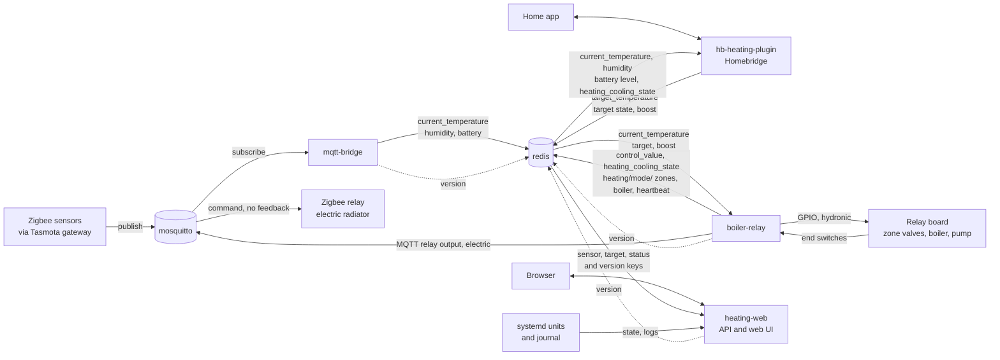

# heating-system

Control software for a house with two heating systems. A BeagleBone runs it all.

- **Hydronic:** a boiler and pump feed radiators through zone valves. The BeagleBone switches them with GPIO relays. Each valve reports back through an end switch, and the boiler runs while any end switch is high.
- **Electric:** a radiator on a Zigbee relay, switched over MQTT. It has no end switch and no other feedback, so its state is never confirmed.

The same sensors, setpoints and control loop serve both. A zone belongs to one system, set by its `system` field in the `boiler-relay` config.

## Parts

| Submodule | Role |
| --- | --- |
| `boiler-relay` | Runs a PID loop per zone. Drives the hydronic GPIO outputs and the boiler, and the electric MQTT relay. Despite the name it controls both systems. |
| `mqtt-bridge` | Copies sensor readings from the MQTT broker into redis. |
| `hb-heating-plugin` | Homebridge plugin. The UI for setpoints, modes and boost. |
| `heating-web` | Read-only API and web interface. Reads redis and is deployed on its own, apart from `boiler-relay`. |

Redis connects all of them. Sensors publish to mosquitto, `mqtt-bridge` writes the readings to redis, Homebridge writes setpoints, and `boiler-relay` reads both and switches the relays. `heating-web` only reads redis and the systemd journal, and serves the API and the web interface. Dotted lines are the version keys each service writes at startup.



The keys, payloads and who writes and reads each are in [docs/redis-contract.md](docs/redis-contract.md).

`boiler-relay` and `mqtt-bridge` track `more_better_modular`. `hb-heating-plugin` tracks `develop`. `heating-web` tracks `main`.

## Clone

```
git clone --recurse-submodules git@github.com:GJMontreal/heating-system.git
```

In an existing clone, run `git submodule update --init`.

## Update the submodules

```
git submodule update --remote
git add boiler-relay mqtt-bridge hb-heating-plugin heating-web
git commit -m "Update submodules"
```

## Deploy

```
./deploy.sh <user> <host> heating-web
./deploy.sh <user> <host> boiler-relay mqtt-bridge
./deploy.sh <user> <host> all
```

The script runs the `deploy.sh` of each part you name, so a part without one cannot be deployed. A part that fails does not stop the others, and the script exits non-zero if any failed.

The script creates the `heating` user on the device first. `boiler-relay` and `mqtt-bridge` install as separate `_v2` services beside the legacy ones and never touch the legacy directories. Their `deploy/switch.sh` moves between the legacy and v2 services. `heating-web` is new and has no legacy twin, so it has no switch. It also reads the control config, so deploy `boiler-relay` first. A deploy copies files and builds the virtualenv. It does not install or start the units. Each part prints the commands to install them. Because `heating-web` has its own unit and directory, it redeploys and restarts without touching the control service.

Each submodule has its own README with setup, running and deploy steps.
