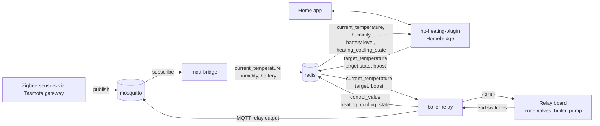

# heating-system

Control software for a zone-valve hydronic heating system. A BeagleBone runs it all and switches relays for the zone valves, the boiler and the pump.

## Parts

| Submodule | Role |
| --- | --- |
| `boiler-relay` | Runs a PID loop per zone and drives the GPIO and MQTT relay outputs. |
| `mqtt-bridge` | Copies sensor readings from the MQTT broker into redis. |
| `hb-heating-plugin` | Homebridge plugin. The UI for setpoints, modes and boost. |

Redis connects all of them. Sensors publish to mosquitto, `mqtt-bridge` writes the readings to redis, Homebridge writes setpoints, and `boiler-relay` reads both and switches the relays.



`boiler-relay` and `mqtt-bridge` track `more_better_modular`. `hb-heating-plugin` tracks `develop`.

## Clone

```
git clone --recurse-submodules git@github.com:GJMontreal/heating-system.git
```

In an existing clone, run `git submodule update --init`.

## Update the submodules

```
git submodule update --remote
git add boiler-relay mqtt-bridge hb-heating-plugin
git commit -m "Update submodules"
```

## Deploy

```
./deploy.sh <user> <host> boiler-relay mqtt-bridge
./deploy.sh <user> <host> all
```

The script runs the `deploy.sh` of each part you name, so a part without one cannot be deployed. A part that fails does not stop the others, and the script exits non-zero if any failed.

Each submodule has its own README with setup, running and deploy steps.
